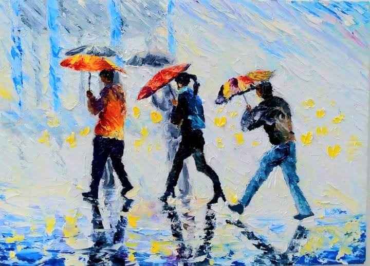
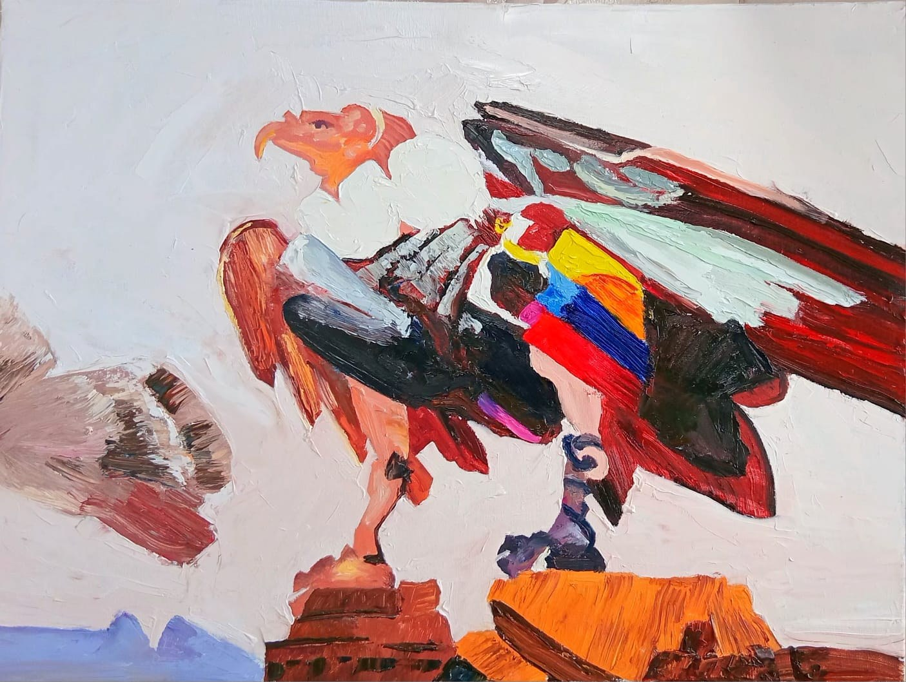
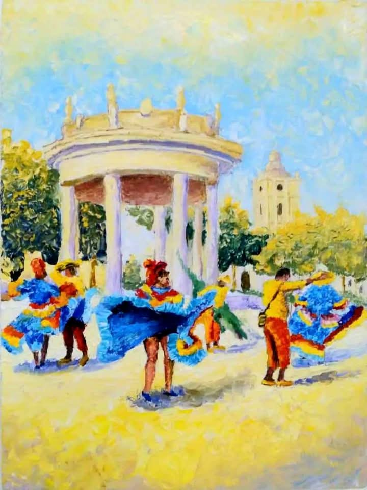
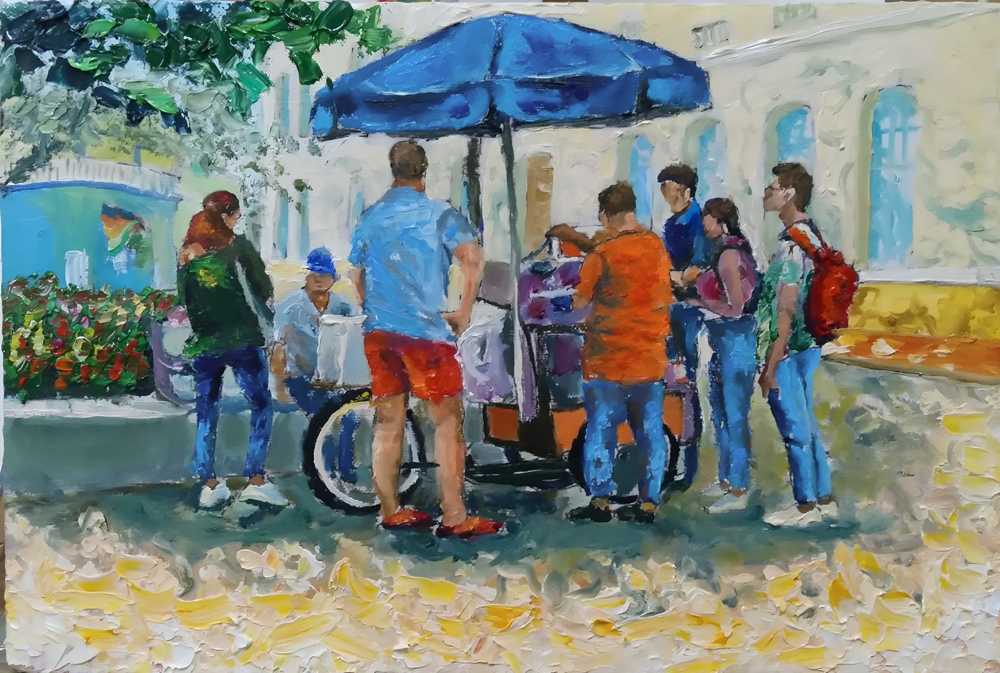
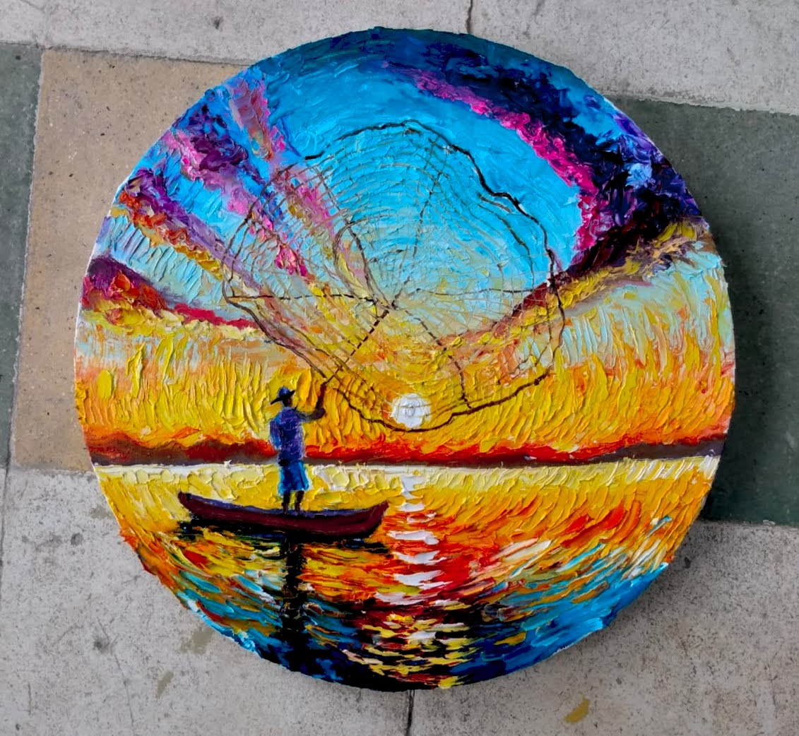
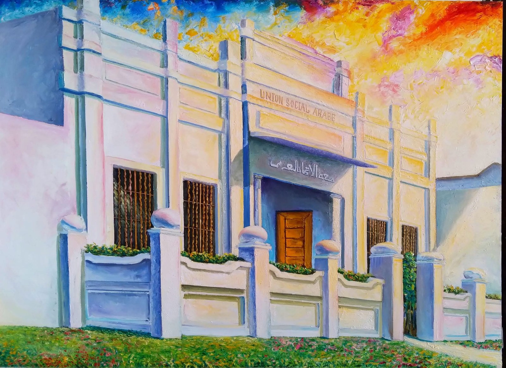

# YEINER MENDOZA

### *Artista plástico · Pintor impresionista*

❦

Soy Yeiner Mendoza, de Ciénaga, Magdalena, Colombia. Pinto al óleo, en impresionismo moderno, con espátula — la luz, el color y la memoria del Caribe colombiano.

> *“Mi obra no solo se contempla… se vive.”*

---

*Está Lloviendo en Macondo, óleo sobre lienzo, 2023*

## Mi dossier

Mi dossier completo, en primera persona, con mi semblanza, mi trayectoria y mis obras. 7 páginas A4.

- **[Dossier en español (PDF)](Dossier_Artista_Yeiner_Mendoza.pdf)**
- **[Artist dossier in English (PDF)](Dossier_Artista_Yeiner_Mendoza_EN.pdf)**
- **[Ver la página web del dossier](https://yeinerimpresionismo.github.io/dossier-artista-yeiner-mendoza/)**

## Obras seleccionadas

| | | |
|---|---|---|
|  |  |  |
| **El Cóndor** · 2025 | **Noche de Romance** · 2024 | **Danza del Caimán** · 2024 |
|  |  |  |
| **La Chica de la Bici** · 2023 | **Raspaos de Macondo** · 2023 | **Pescando** · 2024 |
|  |  |  |
| **Atarrayero** · 2023 | **Casa Árabe** · 2022 | **Está Lloviendo en Macondo** · 2023 |

## Archivos editables

- `dossier-artista-general.html` — fuente en español (WeasyPrint)
- `dossier-artista-general-en.html` — source in English (WeasyPrint)
- `index.html` — página web del dossier (GitHub Pages)
- `obras-fotos/` — fotos de las 9 obras del portafolio

Para regenerar un PDF a partir del HTML: `weasyprint dossier-artista-general.html Dossier_Artista_Yeiner_Mendoza.pdf`

## Contacto

Yeiner Alberto Mendoza Lara — yeinermendozaarte@gmail.com — Ciénaga, Magdalena, Colombia
